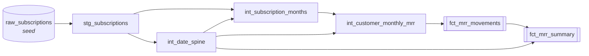

# Subscription Analytics: MRR Models in dbt

[](https://github.com/vaniltonpaulo/Subscription-Analytics-Models-in-dbt/actions/workflows/ci.yml)


A dbt project that turns raw subscription records into the revenue metrics a SaaS finance team reports every month: **MRR, ARR, the MRR waterfall (new, expansion, contraction, churn, reactivation), churn rates, net revenue retention and quick ratio**.

Every number is checked by tests that tie it back to the source data. CI rebuilds the whole project from scratch on every pull request.

---

## What it answers

- How much recurring revenue do we have, and how fast is it growing?
- Where did this month's change in MRR come from: new customers, upgrades, downgrades, churn or win-backs?
- What share of customers and revenue do we lose each month?
- Are existing customers growing or shrinking (net revenue retention)?
- Are we adding revenue faster than we lose it (quick ratio)?

## Results snapshot

Built on 50,000 synthetic subscriptions from about 33,900 customers, with the reporting date pinned to `2025-12-31`:

| | Value |
|---|---|
| Ending MRR | **$1.79M** |
| ARR | **$21.5M** |
| Paying customers | **22,581** |
| MRR growth in 2025 | **+41.7%** ($1.26M → $1.79M) |
| Avg. monthly logo churn (2025) | **2.2%** |
| Avg. monthly net MRR retention (2025) | **98.2%** |
| Avg. quick ratio (2025) | **2.1** |

`fct_mrr_summary`, second half of 2025:

| Month | Starting MRR | New | Reactivation | Expansion | Contraction | Churn | Ending MRR | Logo churn | NRR | Quick ratio |
|---|---:|---:|---:|---:|---:|---:|---:|---:|---:|---:|
| 2025-07 | 1,521,609 | 60,736 | 8,326 | 10,023 | -8,977 | -27,906 | 1,563,811 | 2.05% | 98.2% | 2.14 |
| 2025-08 | 1,563,811 | 64,250 | 11,924 | 12,357 | -8,028 | -36,086 | 1,608,228 | 2.35% | 98.0% | 2.01 |
| 2025-09 | 1,608,228 | 58,793 | 10,227 | 14,674 | -9,435 | -28,193 | 1,654,294 | 1.90% | 98.6% | 2.22 |
| 2025-10 | 1,654,294 | 61,273 | 11,702 | 13,452 | -9,074 | -29,689 | 1,701,958 | 1.97% | 98.5% | 2.23 |
| 2025-11 | 1,701,958 | 58,502 | 9,823 | 13,719 | -11,001 | -29,029 | 1,743,972 | 1.91% | 98.5% | 2.05 |
| 2025-12 | 1,743,972 | 64,494 | 9,443 | 15,234 | -10,611 | -33,236 | 1,789,296 | 2.02% | 98.4% | 2.03 |

Each row balances: starting MRR plus the five movements equals ending MRR, and each month opens where the previous one closed. Tests enforce both.

To reproduce: `dbt build --vars '{mrr_as_of_date: "2025-12-31"}'`

---

## Architecture



| Layer | Model | Grain | Built as | Purpose |
|---|---|---|---|---|
| Staging | `stg_subscriptions` | subscription | view | Clean records, drop invalid rows |
| Intermediate | `int_date_spine` | month | table | Every month from the first subscription to the reporting date |
| Intermediate | `int_subscription_months` | subscription × month | table | Which subscriptions are active in which months |
| Intermediate | `int_customer_monthly_mrr` | customer × month | table | MRR per customer, with zero-MRR months for gaps and churn |
| Mart | `fct_mrr_movements` | customer × month | table | Each customer's movement category per month |
| Mart | `fct_mrr_summary` | month | table | MRR waterfall and SaaS health metrics |

## How MRR movements are classified

Each customer's MRR this month is compared with last month:

| Category | Rule | Example |
|---|---|---|
| `new` | First month the customer pays | — → $29 |
| `expansion` | Pays more than last month | $29 → $79 |
| `contraction` | Pays less, but more than zero | $79 → $29 |
| `churn` | Paid last month, pays nothing now | $79 → $0 |
| `reactivation` | Paid nothing last month, pays now | $0 → $79 |
| `retained` | Same amount | $79 → $79 |

Contraction and churn are stored as **negative** amounts, so the waterfall is a simple sum: `starting_mrr + net_new_mrr = ending_mrr`.

## Metric definitions

| Metric | Definition |
|---|---|
| ARR | `ending_mrr × 12` |
| ARPA | `ending_mrr / ending_customers` |
| Customer (logo) churn rate | `churned_customers / starting_customers` |
| Gross MRR churn rate | `-(contraction_mrr + churned_mrr) / starting_mrr` |
| Net MRR retention | `(starting_mrr + expansion + contraction + churn) / starting_mrr` |
| Quick ratio | `(new + reactivation + expansion) / abs(contraction + churn)` |

Rates are null when the month starts from zero, instead of failing on division by zero. Every column is documented in the model YAML files and in the generated dbt docs (`dbt docs generate && dbt docs serve`).

---

## Testing strategy

**34 data tests and 3 unit tests**, all run by `dbt build` locally and in CI.

| Kind | What it guards | Examples |
|---|---|---|
| **Reconciliation** (singular tests) | The numbers add up | Starting + movements = ending, for MRR and customers · each month opens at the prior month's close · ending MRR matches a separate sum over subscriptions |
| **Unit tests** | The logic is right, on hand-made inputs | All six movement categories · churn month and gap months · rate math and null handling |
| **Grain** | No duplicate rows | `unique_combination_of_columns` on every customer × month and subscription × month model |
| **Domain** | Values make sense | Accepted plan names and categories · MRR ≥ 0 · inflows ≥ 0, outflows ≤ 0 · churn rates between 0 and 1 |
| **Source quality** | Bad raw data gets noticed | Warning-level test on raw rows where `end_date < start_date` (staging drops them) |

### Bugs these tests caught

The first version of this project built without errors, and its tests passed. It was still wrong in two ways:

1. **The date spine was hardcoded to 2024**, while the data spans 2023–2026. 71% of subscriptions fell outside it, and every customer who joined before 2024 was counted as "new" in January 2024. The spine is now derived from the data, up to a configurable reporting date.
2. **Customers who left for good were never counted as churned.** Each customer's months ended at their last paying month, so the zero-MRR month where churn is recorded was never created. Only 1,025 churn events were found; the correct count is 14,987.

Both fixes come with tests that fail against the old logic. Putting the churn bug back makes the unit test fail. It also breaks the "each month opens at the prior month's close" check in 46 of 47 months. The waterfall used to be solved backwards from the ending figure, so it balanced automatically and could never reveal this. Starting MRR is now measured directly, so it can.

---

## Design decisions

- **Monthly grain, no proration.** A subscription counts its full MRR in every month it is active on at least one day. This matches how most SaaS teams report MRR. Daily proration would add complexity without changing the trends.
- **Signed movements.** Storing contraction and churn as negatives makes the waterfall a plain sum and lets tests check it exactly.
- **Configurable reporting date.** `mrr_as_of_date` defaults to today. Pinning it makes results reproducible, for example for month-end close or for the snapshot above.
- **Dormant months kept upstream, dropped downstream.** `int_customer_monthly_mrr` keeps zero-MRR months between churn and reactivation so the month-over-month comparison sees the gap. `fct_mrr_movements` drops them because they carry no movement.
- **Explicit numeric types.** Money columns are cast to fixed-precision decimals, so zero-filled months look the same as real ones.
- **Seed instead of a source.** The data is synthetic, so it's committed as a dbt seed and referenced with `ref()`, which also makes dbt load it before staging. In production, `raw_subscriptions` would be a `source` loaded by an ingestion tool.

## Data

`seeds/raw_subscriptions.csv` is produced by [`scripts/generate_raw_subscriptions.py`](scripts/generate_raw_subscriptions.py). It uses only the Python standard library and a fixed random seed, so it recreates the committed file byte for byte. It models realistic customer behavior: churn on month ends, win-backs after a gap, plan changes, and customers holding several subscriptions at once.

```bash
python scripts/generate_raw_subscriptions.py            # 50,000 rows (committed seed)
python scripts/generate_raw_subscriptions.py 10000000   # 10M rows, about 20 seconds
```

At 10M rows, load the file with Postgres `COPY` and declare it as a dbt `source`: `dbt seed` is not built for files that large.

---

## Run it locally

Requires Python 3.13+ and Docker (or any Postgres 16).

```bash
# 1. Start Postgres
docker run -d --name subscription-pg -p 5432:5432 \
  -e POSTGRES_USER=dbt -e POSTGRES_PASSWORD=dbt -e POSTGRES_DB=subscription_analytics \
  postgres:16

# 2. Install dbt
python -m venv .venv && source .venv/bin/activate
pip install -r requirements.txt

# 3. Point dbt at the database (the same profile CI uses)
export DBT_PROFILES_DIR=ci DBT_HOST=localhost DBT_USER=dbt DBT_PASSWORD=dbt DBT_DBNAME=subscription_analytics

# 4. Build and test everything
dbt deps
dbt build

# 5. Browse the docs and lineage graph
dbt docs generate && dbt docs serve
```

## Continuous integration

[`.github/workflows/ci.yml`](.github/workflows/ci.yml) runs on every pull request and every push to `main`. It starts a fresh Postgres 16 container, installs the pinned dbt versions, runs `dbt build` (seed, models, data tests, unit tests) and generates the docs. Building into an empty database proves the project works from scratch, not only on a warehouse that already has tables in it. Credentials come from environment variables, and none are committed.

## Project structure

```
├── .github/workflows/ci.yml     # CI: dbt build on Postgres for every PR
├── ci/profiles.yml              # connection profile, all values from env vars
├── models/
│   ├── staging/                 # stg_: cleaning
│   ├── intermediate/            # int_: date spine, monthly MRR, gap filling
│   └── marts/                   # fct_: movements and monthly summary
├── seeds/                       # raw_subscriptions.csv + its tests
├── tests/                       # reconciliation tests
├── scripts/                     # synthetic data generator
├── dbt_project.yml
├── packages.yml                 # dbt_utils
└── requirements.txt             # pinned dbt versions
```

## Roadmap

- **Retention cohorts**: logo retention, NRR and GRR by signup-month cohort (`fct_retention_cohorts`).
- **Model contracts** on the marts, to enforce column names and types at build time.
- **Generator**: keep acquiring new customers through the final months of the date range.
